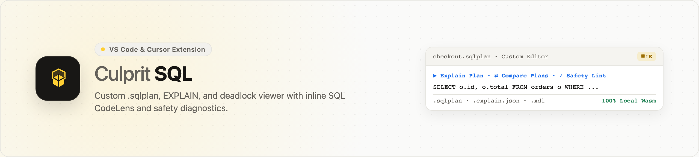

<picture>
  <source media="(prefers-color-scheme: dark)" srcset="https://raw.githubusercontent.com/culpritsql/culprit-vscode/main/assets/hero-dark.png">
  <source media="(prefers-color-scheme: light)" srcset="https://raw.githubusercontent.com/culpritsql/culprit-vscode/main/assets/hero-light.png">
  
</picture>

 

**Interactive SQL execution plan diagrams, structural Before vs After plan diffs, deadlock cycle graphs, and SQL migration safety checks for VS Code, Cursor, and Windsurf.**
 
Running 100% locally in WebAssembly via [`@culpritsql/plans`](https://github.com/culpritsql/culprit-plans) and [`@culpritsql/plan-viewer`](https://github.com/culpritsql/culprit-plan-viewer).

[Try Online at explain.culpritsql.com](https://explain.culpritsql.com) · [Features](#feature-highlights) · [Shortcuts](#commands--keyboard-shortcuts) · [Engines](#supported-engines--formats) · [Security](#security--privacy)

---

## Feature Highlights

- **Zero-Click Custom Editor**: Double-click any `*.sqlplan`, `*.explain.json`, `*.plan.json`, or `*.xdl` file in Explorer to open an interactive operator flow diagram or deadlock wait graph. Live edits stream directly into the viewer.
- **Interactive Plan & Deadlock Studio (`Cmd+Shift+E` / `Ctrl+Shift+E`)**: Paste `EXPLAIN (ANALYZE, BUFFERS)` output, Showplan XML, MySQL `EXPLAIN ANALYZE`, or server deadlock logs without creating scratch files.
- **Side-by-Side Structural Plan Diff**: Select two plan files in Explorer and click **Culprit: Compare Two Execution Plans** to inspect measured speedup, cost ratio, `Seq Scan` to `Index Scan` access flips, and operator property changes with synchronized pan and zoom.
- **Inline CodeLens & SQL Migration Safety Diagnostics**:
  - Adds `⚡ Culprit: Paste EXPLAIN · ⇄ Compare Plan` lenses above queries in `.sql` files and `sql\`...\`` / `Prisma.$queryRaw\`...\`` template literals in TypeScript and JavaScript.
  - Flags risky SQL constructs before production deploy: `UPDATE` / `DELETE` without `WHERE`, `CREATE INDEX` without `CONCURRENTLY` on existing tables, `CREATE INDEX CONCURRENTLY` inside `BEGIN ... COMMIT`, non-sargable `WHERE LOWER(col) = ...` predicates, and leading-wildcard `LIKE '%...'` filters.
- **Redacted Share Links & Standalone Exports**: Export single-file HTML or Markdown reports, or generate compressed `explain.culpritsql.com/#s=z1...` URLs with SQL string and numeric literals scrubbed automatically.
- **Native Theme Sync**: Follows VS Code, Cursor, and Windsurf Dark, Light, and High Contrast themes automatically.

---

## Commands & Keyboard Shortcuts

| Command | Shortcut | Description |
| :--- | :--- | :--- |
| `Culprit: Open SQL Plan & Deadlock Studio` | `Cmd+Shift+E` (`Ctrl+Shift+E`) | Opens the interactive Plan, Compare, and Deadlock Studio panel |
| `Culprit: Explain Plan or Deadlock from Clipboard` | Command Palette / Context Menu | Parses and renders `EXPLAIN` or deadlock output directly from your clipboard |
| `Culprit: Explain Selected Plan / Deadlock` | Editor Selection Context Menu | Visualizes the highlighted execution plan, deadlock log, or SQL query |
| `Culprit: Compare Two Execution Plans` | Explorer Context Menu (2 files) | Opens structural Before vs After comparison for selected plan files |
| `Culprit: Open Redacted Link on explain.culpritsql.com` | Command Palette | Scrubs SQL literals, compresses with `deflate-raw`, and opens in browser |

---

## Supported Engines & Formats

| Engine | Execution Plan Formats | Deadlock Formats |
| :--- | :--- | :--- |
| **PostgreSQL & TimescaleDB** | `EXPLAIN (ANALYZE, BUFFERS, WAL, VERBOSE, FORMAT JSON)` & plain `psql` text | `ERROR: deadlock detected` + `DETAIL:` server log excerpts |
| **SQL Server & Azure SQL** | `.sqlplan` Showplan XML (Estimated & Actual runtime counters, missing indexes, spills) | `.xdl` / Extended Events `<deadlock>` XML graphs |
| **MySQL & MariaDB** | `EXPLAIN FORMAT=JSON` & MySQL 8.0+ `EXPLAIN ANALYZE` tree text | `SHOW ENGINE INNODB STATUS` (`LATEST DETECTED DEADLOCK`) |
| **YugabyteDB** | `EXPLAIN (ANALYZE, DIST, FORMAT JSON)` with DocDB RPC & storage read metrics | PostgreSQL-compatible deadlock log excerpts |
| **SQLite / LibSQL** | `EXPLAIN QUERY PLAN` (`--SCAN` / `--SEARCH` tree and classic tabular output) | N/A |

---

## Extension Settings

| Setting | Default | Description |
| :--- | :--- | :--- |
| `culprit.codeLens.enabled` | `true` | Show inline `Paste EXPLAIN` and `Compare Plan` CodeLenses above SQL statements and tagged templates. |
| `culprit.diagnostics.enabled` | `true` | Enable static SQL query and migration safety diagnostics in `.sql` and `.ts`/`.tsx`/`.js` files. |
| `culprit.share.redactLiterals` | `true` | Scrub SQL string and numeric literals before generating shareable links or exported reports. |

---

## Security & Privacy

1. **100% Local WebAssembly Execution**: Plan parsing, structural diffing, deadlock cycle detection, and HTML/Markdown rendering run locally inside `@culpritsql/plans` WebAssembly. No database credentials, queries, or plans are uploaded to any server.
2. **Strict Webview Content Security Policy**: Every Webview renders under a per-session cryptographic `nonce` (`default-src 'none'; script-src 'nonce-...' 'wasm-unsafe-eval'`) with zero remote scripts or telemetry beacons.
3. **Client-Side Redacted Sharing**: Sharing to `explain.culpritsql.com` is strictly opt-in, scrubs SQL literals by default, and stores the compressed payload inside the URL `#s=z1...` fragment so the payload is never sent in HTTP request paths.

---

## License

MIT License. Copyright (c) 2026 Cristian Pufu.
